# Hi, I'm Leo Moura 🌱

Developer, writer, and artist from Porto Alegre, Brazil.

I'm a software engineer at [Alliance](https://alliance.xyz/), the leading crypto accelerator and founder community, where I build governance and infrastructure. Before that I worked on the Microsoft Search home and query assist, and on HP's Alexa skill and IFTTT integration.

I have a B.Sc. and M.Sc. in Computer Science from UFRGS and studied Systems Engineering at Ensimag (Grenoble, France).

📝 **Digital garden:** [leomoura.org](https://leomoura.org)

## Latest posts

<!-- BLOG-POST-LIST:START -->
- [How Implicit Is Your Code?](https://leomoura.org/2025/12/08/how-implicit-is-your-code/)
- [npm install emotional-awareness](https://leomoura.org/2024/03/17/emotional-awareness-for-software-engineers/)
- [Bringing Life to the Blockchain](https://leomoura.org/2023/11/15/briging-life-to-the-blockchain/)
- [Intelligence Will Eat the World](https://leomoura.org/2023/04/23/intelligence-will-eat-the-world/)
- [Introducing BlockSlots](https://leomoura.org/2023/03/10/blockslots-slot-machine-launch/)
<!-- BLOG-POST-LIST:END -->

## Find me

[Website](https://leomoura.org) · [𝕏](https://twitter.com/lfsmoura) · [Bluesky](https://bsky.app/profile/lfsmoura.bsky.social) · [Farcaster](https://warpcast.com/lfsmoura) · [LinkedIn](https://www.linkedin.com/in/leonardomoura)
